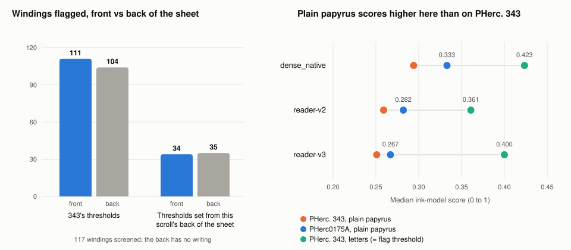
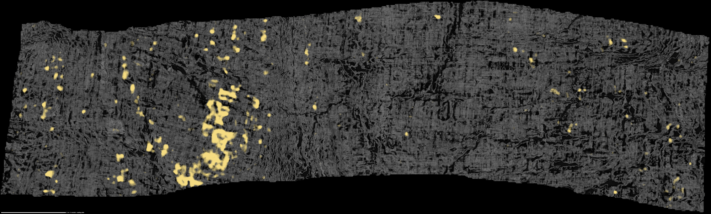
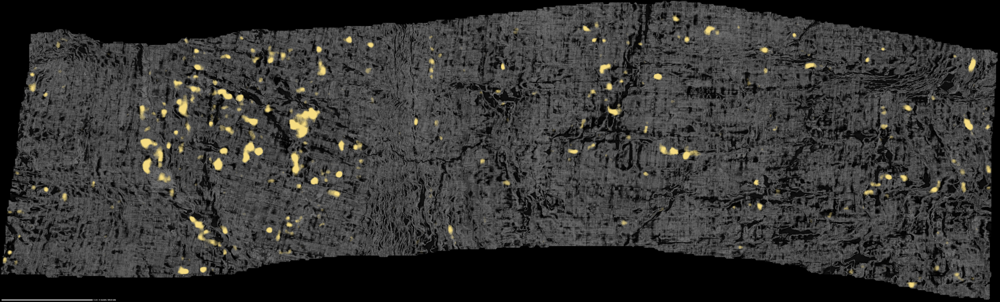

# First Light — PHerc0175A

I ran the method that found PHerc. 343's first letters on PHerc0175A, with the same pipeline as my earlier attempt on PHerc. 1218 ([first-light-pherc1218](https://github.com/jake-vc/first-light-pherc1218)). I found no
ink in my initial search but stopped due to some concerns around ink detection. This repo has three main takeaways for others following in the 343 footsteps:

1. **On this scroll, the ink models pick up the structure of the papyrus, not ink.** The screen flagged 111 of 117
   windings on the front of the sheet, and 104 on the back, where there is no writing. Since the front/back sides are almost as frequent, we know that we aren't detecting ink but the papyrus itself. I checked the strongest windings by eye in an initial search, and they confirmed this belief.
2. **The groundwork is on Hugging Face,** so if cross-scroll ink detection improves, there is a clean starting point. It contains fitted and flattened meshes for two sections, the ink maps of every screened winding, and the fit checkpoints.
3. **Independent measurements of three villa proposals** on real data, centered around process improvements: running several models side by side (ScrollPrize/villa#2213), loading a model once for all depths (ScrollPrize/villa#1872), and comparing the two faces of the sheet (ScrollPrize/villa#2318).

## What I did

- I fitted one 2.6 cm tall section of the scroll (slices 4,800-7,800) and flattened every winding in it.
- I screened the 117 windings that sat well on the papyrus (2,090 cm²) with three ink models, using rules I wrote down
  before looking.
- I looked at the ten strongest windings by eye, whole, with six ink models, front and back.
- I prepared a second section (slices 7,600-10,600, 113 windings) up to the point of screening but did not continue further.

## What I found

The strongest winding (w114) by the screen's ranking, with the ink models' signal in yellow.
  Top: the front of the sheet, where writing would be.
  Bottom: the back, where there is none. I judged it and other strong windings as not ink.

**The models see the papyrus, not ink.** The back of the sheet has no writing, yet it flagged almost as many
windings as the front (104 vs 111), meaning the flags come from the papyrus. This scroll's plain papyrus simply scores higher with the ink models than 343's does; for two of the three models, its brightest tenth already reaches the level of 343's letters:

| Ink model | Plain papyrus, PHerc0175A | Plain papyrus, PHerc. 343 | Letters, PHerc. 343 |
|---|---|---|---|
| dense_native | 0.333 | 0.294 | 0.424 |
| reader-v2 | 0.282 | 0.259 | 0.361 |
| reader-v3 | 0.267 | 0.251 | 0.400 |

Two small caveats:
  - The front did flag somewhat more area than the back, which may be a bias of models trained to read the front, or faint ink; nothing on the front stood out once each side was judged against its own background (below).
  - The back is not necessarily a perfect blank always: on 343 the models still see a little of the letters from the back.

**The back of the sheet is a free control.** On 343, the models see the letters on the front and very little on the
back. On a new scroll, if the back flags nearly as many windings as the front, the models are picking up background.
Anyone moving the 343 method to a new scroll can run this check on the first section before paying for a review.
[ScrollPrize/villa#2318](https://github.com/ScrollPrize/villa/pull/2318) proposes the same idea as a tool; this is a
test of it at scale, on 117 whole windings of a new scroll.

**A second try with fair thresholds.** I set new thresholds from the back of the sheets themselves, so that only 0.1%
of the back passes, and screened again. The front flagged 34 windings and the back 35: nothing on the front stood
out from the background.

**The limit of this result.** The same fair thresholds also miss 343's own letters. On this scroll, letters as faint
as 343's would hide in the background noise at the 4 mm scale the screen uses. So the result at this current time is that we have no ink that these models can detect here.

Every rule change was written down and committed before I ran it ([`prereg/`](prereg/readout.md), with its full
history).

## Measuring three villa proposals

The ink models spend most of their time loading and preparing data on the CPU; the GPU was busy only 7-17% of the
time. Two villa proposals use this imbalance to increase efficiency. I measured them on this data, and the output matched to the pixel.

| Change | Gain |
|---|---|
| Run the three ink models side by side on one GPU instead of one after another (as documented in [ScrollPrize/villa#2213](https://github.com/ScrollPrize/villa/pull/2213)) | about 2.4x |
| Load each model once for all depths instead of once per depth (the approach of [ScrollPrize/villa#1872](https://github.com/ScrollPrize/villa/pull/1872)) | about 34 s saved per extra depth |

Rendering on a separate CPU machine, not on the GPU machine, gained another 2x. Together: the same three-model
screen took about 74 s per cm² on [PHerc. 1218](https://github.com/jake-vc/first-light-pherc1218), 14 s per cm² here overnight, and about 6 s per cm² on a GPU machine doing nothing else. At that speed, screening a 2,000 cm² section costs about $3.50.

Other process improvements were attempted (more data-loader workers (slower), temporary files in memory (no change), and copying the input into memory (no change)), with no success. Details and every measurement are available in [`analysis/`](analysis/README.md).

## Recommendations/Helpers for the next person working with PHerc. 0175a:
- **Meshes ready to render:** both sections, fitted, snapped to the papyrus and flattened (230 windings).
- **Ink maps for all 117 screened windings,** so a better threshold or a new analysis needs no GPU.
- **Fit checkpoints,** to continue or re-export the fits.
- **The back-of-sheet check:** run it on the first section of any new scroll before paying for a review.
- **What to try next,** if a better ink model appears: screen these meshes with it, run the back-of-sheet check,
  and sweep depth only on the spots that pass.

## Data

- **Hugging Face:** [Jake-vc/first-light-pherc0175a](https://huggingface.co/datasets/Jake-vc/first-light-pherc0175a)
  (14 GB). The meshes of both sections, ready to render; the ink maps of all 117 screened windings, so every number
  here can be checked without a GPU; the screening results; and the fit checkpoints. Its README says where to start.
- **This repo:** the images ([`renders/`](renders/INDEX.md)), the verdicts and measurements ([`analysis/`](analysis/README.md)),
  the rules ([`prereg/`](prereg/readout.md)), the decision log ([`logs/`](logs/DECISIONS.md)) and every script
  ([`runbook/`](runbook/README.md)).

## Cost

$15.21 of RunPod time: $11.01 for GPU machines (mostly one machine for about 10 hours), $3.79 for CPU machines, and
$0.41 for storage.

## Reproduce it

[`runbook/README.md`](runbook/README.md) lists every script in order. In short: villa main's spiral fitter with
automatic step count, snapping and flattening as the 343 winners did, VC3D to render, and villa's ink inference with
reader-v3, dense_native and reader-v2.

Two of the villa PRs from my PHerc. 1218 attempt were used or needed again here:
- [ScrollPrize/villa#2323](https://github.com/ScrollPrize/villa/pull/2323) (automatic stop for headless fits): both
  fits on this scroll ran with it.
- [ScrollPrize/villa#2290](https://github.com/ScrollPrize/villa/pull/2290) (cache size limit for the command-line
  renderer): rendering filled a machine's disk again; until it is merged, a script that trims the cache works around it.

## How this was built

I worked with an AI coding agent (Claude Opus 5.5, via Claude Code). It wrote the scripts, ran the machines, checked
the results and drafted the repo. I chose the scroll, approved all spending, judged every image by eye, wrote the
readme above and published this repo.

## Credits and licences

Nieuwlaar (pherc343-first-letters, MIT), DomRusso2 (reader-v2/v3, MIT), SharpMeow (lasagna fields and center lines),
millerandmuller and bnleft (documented-attempt format, MIT), the Vesuvius Challenge team (villa, VC3D, models, data:
CC BY-NC 4.0). Code in this repo: MIT.
